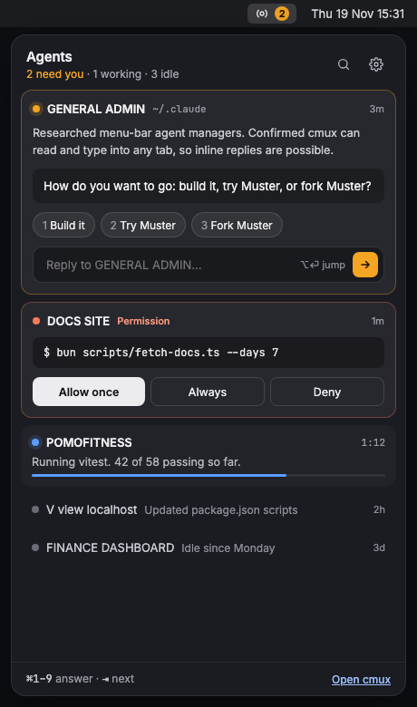
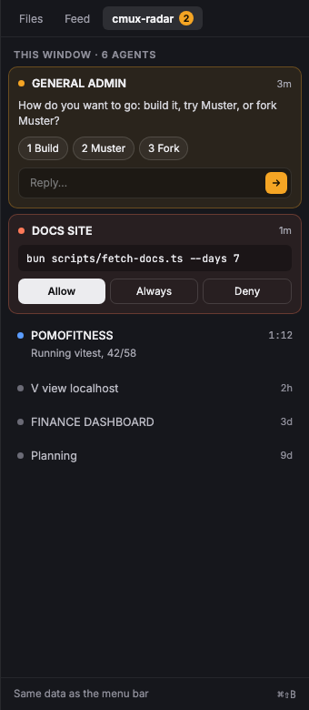
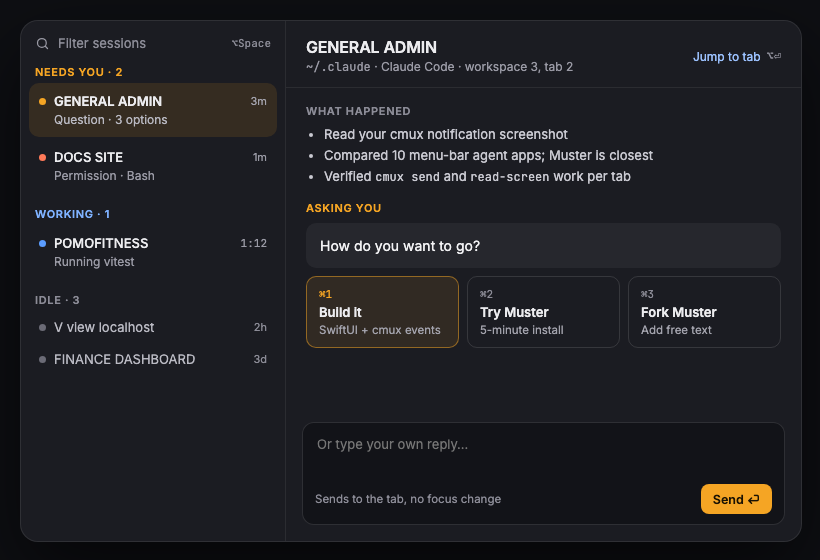
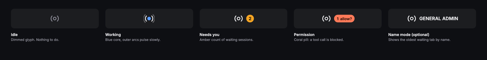
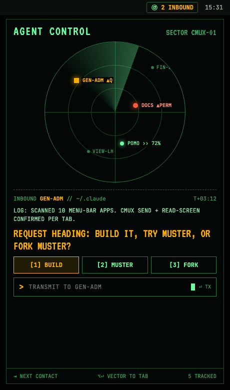
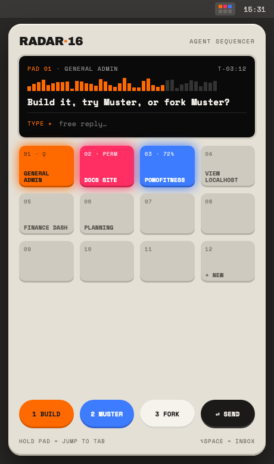
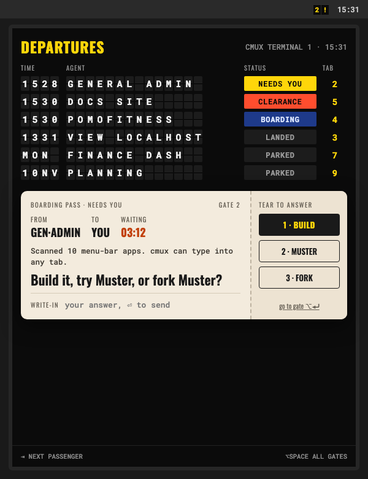
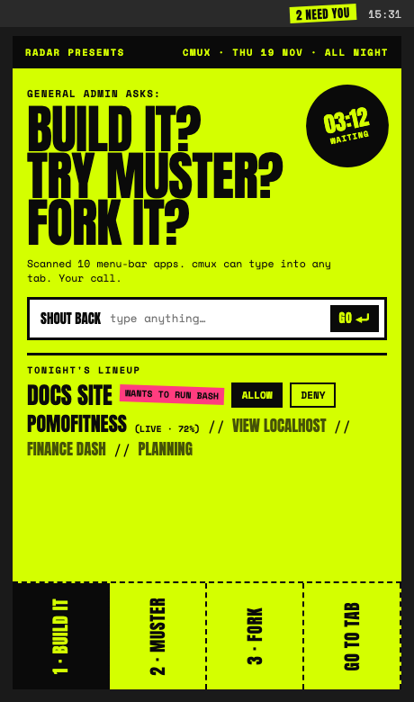

# Mockups

The v1 design mockups: the surfaces the app ships with and the four skin directions. Each one is a static HTML page (open it in a browser; fonts load from Google Fonts) with a PNG render beside it. Session names, questions and commands are sample data.

These are references, not specs. The component contract is [`../components.md`](../components.md), and where the native build differs (system fonts, ⌘] instead of ⇥ for the next caller) the native build wins.

## Surfaces

| Mockup | What it shows |
|---|---|
| [Classic popover](classic-popover.html) | The default menu bar popover: a question with quick replies, a permission request, a working session and idle ones. |
| [Inbox panel](inbox-panel.html) | The ⌥Space keyboard-first panel: sessions grouped by status, the selected one's summary, question and reply box. |
| [cmux sidebar](cmux-sidebar.html) | The cmux right-sidebar extension, same data as the menu bar. |
| [Menu bar icons](menu-bar-icons.html) | Icon states: idle, working, needs you, permission, and the optional name mode. |

 

## Skins

| Skin | Status | Mockup |
|---|---|---|
| Radar | v1 | [skin-radar.html](skin-radar.html) |
| Groovebox | open for contribution | [skin-groovebox.html](skin-groovebox.html) |
| Departures | open for contribution | [skin-departures.html](skin-departures.html) |
| Flyer | open for contribution | [skin-flyer.html](skin-flyer.html) |

 

 
